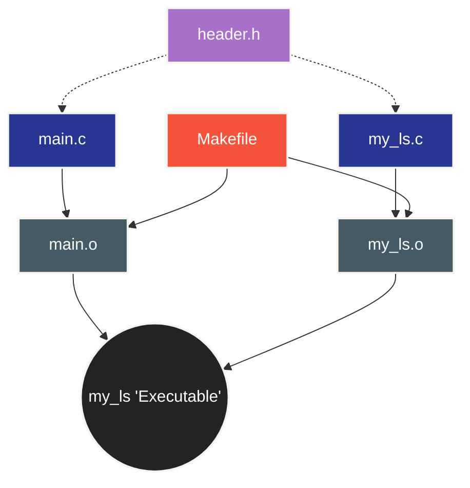

<p align="center">

</p>

<br />

<div align="center">
  <a href="https://getbifrost.ai" target="_blank" rel="noopener">
    
  </a>
  &nbsp;&nbsp;
  <a href="https://koor.fr" target="_blank" rel="noopener">
    
  </a>
  &nbsp;&nbsp;
  <a href="https://koor.fr" target="_blank" rel="noopener">
    
  </a>
  &nbsp;&nbsp;
  <a href="https://learn.microsoft.com/fr-fr/windows/wsl/install" target="_blank" rel="noopener">
    
  </a>
</div>


<br />
<br />
<br />
<br />
<br />
<br />

<div align="center">

# Project Title/Name

<br />


<br/>

*"Image legend"*

</div>

<br />
<br />

<div align="center">

## {🗂️}\ Summary

<br />

<h3>
  <a href="#context" style="text-decoration: none;">
    <kbd style="font-size: 0.9em; padding: 0.3em 0.6em; font-weight: bold;">Context</kbd>
  </a>
</h3>


<br />

<h3>
  <a href="#guide" style="text-decoration: none;">
    <kbd style="font-size: 0.9em; padding: 0.3em 0.6em; font-weight: bold;">Guide</kbd>
  </a>
</h3>

<br />

<h3>
  <a href="#more-information" style="text-decoration: none;">
    <kbd style="font-size: 0.9em; padding: 0.3em 0.6em; font-weight: bold;">More Information</kbd>
  </a>
</h3>

<br />

<h3>
  <a href="#download" style="text-decoration: none;">
    <kbd style="font-size: 0.9em; padding: 0.3em 0.6em; font-weight: bold;">Download</kbd>
  </a>
</h3>

<br />

<h3>
  <a href="#future" style="text-decoration: none;">
    <kbd style="font-size: 0.9em; padding: 0.3em 0.6em; font-weight: bold;">Future</kbd>
  </a>
</h3>

<br />

<h3>
  <a href="#credits" style="text-decoration: none;">
    <kbd style="font-size: 0.9em; padding: 0.3em 0.6em; font-weight: bold;">Credits</kbd>
  </a>
</h3>

<br />
<br />

> Clickable Buttons !

</div>

<br />
<br />


<div align="center">

<h2 id="context">{📚}\ Context</h2>

</div>

<br />

> ---
>
> "Text".
>
> ---

<br />

<div align="center">


<br />

*"Language C Logo"*


<br />
<br />

<h2 id="guide">{📖}\ Guide</h2>

</div>

<br />

> <a href="https://docs.getbifrost.ai/deployment-guides/how-to/install-make" target="_blank" rel="noopener">
>  
> </a>
> <br>
> <br>
> 
> "Text".

```Makefile
CC = gcc # Definition of the used C compilator.
NAME = my_ls # Name of the final executable.
CFLAGS = -Wall -Wextra -Werror -D_DEFAULT_SOURCE # Strict compilations settings + _DEFAULT_SOURCE for st_mtim.
SRCS = main.c my_ls.c # List of the C files to compile.
OBJS = $(SRCS:.c=.o) # List of the objects files (.o) generated from the "files.c".

# Principal rule who activate the compilation of the executable.
all: $(NAME)

# Rule to create the final executable (my_ls).
$(NAME):$(OBJS)
	$(CC)$(CFLAGS) $(OBJS) -o$(NAME) 

# Generic rule to compile every ".c" into ".o" without linking.
%.o: %.c header.h
	$(CC)$(CFLAGS) -c $< -o$@ 

# Rule to delete objects files (.o).
clean:
	rm -f $(OBJS) 

# Rule to delete all the objects files and the executable.
fclean: clean
	rm -f $(NAME) 

# Rule to recompile the project from zero.
re: fclean all

# Declare the targets who are not the names of reals files.
.PHONY: all clean fclean re
```

<br />
<br />
<br />
<br />

> <a href="https://koor.fr/C/Tutorial/Qualificateurs.wp" target="_blank" rel="noopener">
>  
> </a>
> <br>
> <br>
> 
> "Text".

```c
#ifndef HEADER_H /* Protect against the double inclusion of header.h. */
#define HEADER_H /* Define the macro guard of the inclusion. */

#ifndef _DEFAULT_SOURCE /* Vérify if _DEFAULT_SOURCE is not already defined. */
#define _DEFAULT_SOURCE /* Activate the extensions POSIX/BSD like st_mtim. */
#endif /* End of the condition #ifndef _DEFAULT_SOURCE. */

#include <dirent.h> /* For: opendir, readdir, closedir and struct dirent. */
#include <stdio.h> /* For: printf (the visual render on the console). */
#include <stdlib.h> /* For: malloc, free et NULL. */
#include <sys/stat.h> /* For: stat, lstat, struct stat and S_ISDIR. */
#include <sys/types.h> /* For: standars systems types (time_t, etc.). */
#include <time.h> /* For: types related to the time. */

typedef struct s_file /* Start of the structure representing a directory entry. */
{ /* Opening bloc of the structure s_file. */
    char *name; /* Name of the driectory entry. */
    time_t sec; /* Secondes of the timestamp modification (st_mtim.tv_sec). */
    long nsec; /* Nanosecondes of the timestamp modification (st_mtim.tv_nsec). */
} t_file; /* Alias of the type t_file for struct s_file. */

typedef struct s_operand /* Start of the structure representing of the operand CLI. */
{ /* Opening bloc of the structure s_operand. */
    char *name; /* String passed into an argument on the command line. */
    int is_dir; /* Worth 1 if the operand is a directory, else 0. */
    time_t sec; /* Secondes of the timestamp modification. */
    long nsec; /* Nanosecondes of the timestamp modification. */
} t_operand; /* Alias of the type t_operand for struct s_operand. */

void my_ls(int argc, char *argv[]); /* Prototype of the principal function my_ls. */

#endif /* End of the HEADER_H guard inclusion. */
```

<br />
<br />
<br />
<br />

> <a href="https://koor.fr/C/Tutorial/Index.wp" target="_blank" rel="noopener">
>  
> </a>
>
> <br />
>
> ### main.c:
> 
> "Text".

```c
#include "header.h" // Include the definitions, structures and prototypes of the projet.

int main(int argc, char *argv[]) // Standard entry point of the C program.
{ // Start of the main function.
    my_ls(argc, argv); // Call the function my_ls.
    return 0; // Return 0 to indicate a normal execution.
} // End of the main function.
```

<br />
<br />
<br />
<br />

> <a href="https://koor.fr/C/Tutorial/Index.wp" target="_blank" rel="noopener">
>  
> </a>
>
> <br />
>
> ### my_ls.c:
> 
> "Text".

```c
code
```

<br />
<br />
<br />
<br />

<div align="center">

<h2 id="more-information">{🗞️}\ More Information</h2>

<em>"Text".</em>

<br />

</div>

> ---
> 
> "Text".
> 
> ---

> [!NOTE]
> "Text".

<br />
<br />

> [!WARNING]
> "Text".

<br />
<br />
<br />

<div align="center">

<h2 id="download">{📥}\ Download</h2>

</div>

<br />

> ---
>
> #### Prerequisites:
> **Make sure** you have **installed** on your **system**:
>
> <br>
> 
> <a href="https://code.visualstudio.com/docs/cpp/config-mingw" target="_blank" rel="noopener">
> 
> </a>
>  ,
> <a href="https://docs.getbifrost.ai/deployment-guides/how-to/install-make" target="_blank" rel="noopener">
>  
> </a> 
> and 
> <a href="https://learn.microsoft.com/fr-fr/windows/wsl/install" target="_blank" rel="noopener">
> 
> </a>
>
> <br>
> <br>
> <br>
> <br>
> 
> "Text":
>```bash
> command to copy
>```
>
> <br />
> <br />
> 
> "Text":
> 
>```bash
> command to copy
>```
>
> <br />
> <br />
> 
> The **project** can be directly downloaded on **GitHub**.
>
> ---

<br />
<br />
<br />

| File | Description | 
|:---:|:---:|
|**Makefile**| "Text".|
|**header.h**| "Text".|
| **main.c** | "Text". |
| **my_ls.c** | "Text". |

<br />
<br />

```text
{🗂️}: My_Ls/
|
├── [📁]Readme_assets/
│   └── *All the assets of the "[📖]/README.md"*
|
├── [🧩]/header.h
├── [📄]/main.c
├── [⚙️]/Makefile
├── [📄]/my_ls.c
└── [📖]/README.md
```

<br />
<br />

<div align="center">



*"Project Composition"* 

</div>

<br />
<br />
<br />
<br />
<br />
<br />

<div align="center">

<h2 id="future">{🌌}\ Future</h2>

</div>

<br />

> ---
>
> "Text".
>
> ---

<br />
<br />
<br />
<br />
<br />
<br />

<div align="center">

<h2 id="credits">{📌}\ Credits</h2>

</div>

<br />

<p align="center">

<a href="https://github.com/EliasFCS" target="_blank" rel="noopener">
  
</a>

</div>