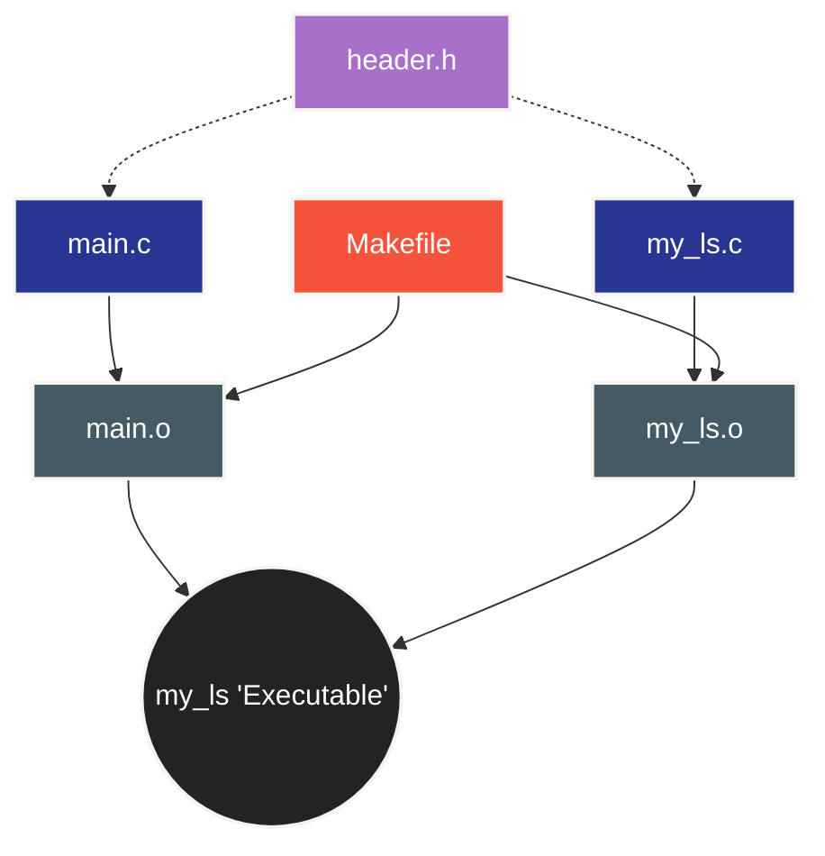

<p align="center">

</p>

<br />

<div align="center">
  <a href="https://getbifrost.ai" target="_blank" rel="noopener">
    
  </a>
  &nbsp;
  <a href="https://koor.fr" target="_blank" rel="noopener">
    
  </a>
  &nbsp;
  <a href="https://koor.fr" target="_blank" rel="noopener">
    
  </a>
  &nbsp;
  <a href="https://learn.microsoft.com/fr-fr/windows/wsl/install" target="_blank" rel="noopener">
    
  </a>
</div>


<br />
<br />
<br />
<br />
<br />
<br />

<div align="center">

# Ls

<br />


<br/>

*"Picture of a list"*

</div>

<br />
<br />

<div align="center">

## {🗂️}\ Summary

<br />

<h3>
  <a href="#context" style="text-decoration: none;">
    <kbd style="font-size: 0.9em; padding: 0.3em 0.6em; font-weight: bold;">Context</kbd>
  </a>
</h3>


<br />

<h3>
  <a href="#guide" style="text-decoration: none;">
    <kbd style="font-size: 0.9em; padding: 0.3em 0.6em; font-weight: bold;">Guide</kbd>
  </a>
</h3>

<br />

<h3>
  <a href="#more-information" style="text-decoration: none;">
    <kbd style="font-size: 0.9em; padding: 0.3em 0.6em; font-weight: bold;">More Information</kbd>
  </a>
</h3>

<br />

<h3>
  <a href="#download" style="text-decoration: none;">
    <kbd style="font-size: 0.9em; padding: 0.3em 0.6em; font-weight: bold;">Download</kbd>
  </a>
</h3>

<br />

<h3>
  <a href="#future" style="text-decoration: none;">
    <kbd style="font-size: 0.9em; padding: 0.3em 0.6em; font-weight: bold;">Future</kbd>
  </a>
</h3>

<br />

<h3>
  <a href="#credits" style="text-decoration: none;">
    <kbd style="font-size: 0.9em; padding: 0.3em 0.6em; font-weight: bold;">Credits</kbd>
  </a>
</h3>

<br />
<br />

> Clickable Buttons !

</div>

<br />
<br />


<div align="center">

<h2 id="context">{📚}\ Context</h2>

</div>

<br />

> ---
>
> "Text".
>
> ---

<br />

<div align="center">


<br />

*"Language C Logo"*


<br />
<br />

<h2 id="guide">{📖}\ Guide</h2>

</div>

<br />

> <a href="https://docs.getbifrost.ai/deployment-guides/how-to/install-make" target="_blank" rel="noopener">
>  
> </a>
> <br>
> <br>
> 
> First, I created a **`Makefile`** to compile the project using **`gcc`** with strict warning flags (**"`-Wall -Wextra -Werror`"**). These flags enable **compiler warnings and treat them as errors**. The Makefile also creates the **"`my_ls`" executable**.
> <br>
>
> #### Compilation & Build
>
> The project includes a **Makefile** to handle compilation with **`gcc`**. To improve **code quality** and **detect potential** issues **during compilation**, the project uses the **following compiler flags: "`-Wall -Wextra -Werror`"**.
> <br>
>
> #### Available Rules:
>
> * **`make`: Compiles the project** and generates the **"`my_ls`" executable**.
> <br>
>
> * **`make clean`:** **Removes object files** (**`.o`**).
> <br>
>
> * **`make fclean`:** **Removes object files** and the **generated executable**.
> <br>
> 
> * **`make re`:** Performs a **clean re-compilation**.

```Makefile
CC = gcc # Definition of the used C compilator.
NAME = my_ls # Name of the final executable.
CFLAGS = -Wall -Wextra -Werror -D_DEFAULT_SOURCE # Strict compilations settings + _DEFAULT_SOURCE for st_mtim.
SRCS = main.c my_ls.c # List of the C files to compile.
OBJS = $(SRCS:.c=.o) # List of the objects files (.o) generated from the "files.c".

# Principal rule who activate the compilation of the executable.
all: $(NAME)

# Rule to create the final executable (my_ls).
$(NAME):$(OBJS)
	$(CC)$(CFLAGS) $(OBJS) -o$(NAME) 

# Generic rule to compile every ".c" into ".o" without linking.
%.o: %.c header.h
	$(CC)$(CFLAGS) -c $< -o$@ 

# Rule to delete objects files (.o).
clean:
	rm -f $(OBJS) 

# Rule to delete all the objects files and the executable.
fclean: clean
	rm -f $(NAME) 

# Rule to recompile the project from zero.
re: fclean all

# Declare the targets who are not the names of reals files.
.PHONY: all clean fclean re
```

<br />
<br />
<br />
<br />

> <a href="https://koor.fr/C/Tutorial/Qualificateurs.wp" target="_blank" rel="noopener">
>  
> </a>
> <br>
> <br>
> 
> Next, I created a **custom header** file (**header.h**) to keep the codebase organized. It includes **essential standard libraries** (**`<stdio.h>, <stdlib.h>, <dirent.h>, <time.h>, <sys/stat.h>`** and **`<sys/types.h>`**). By **including this header** in **source files**, the **implementation code** remains **clean** and **focused** strictly on the **execution logic**.
> <br>
>
>#### Standard Libraries Included:
>
> * **`<stdio.h>`:** Standard **Input/Output operations**.
> <br>
>
> * **`<stdlib.h>`:**
> <br>
>
> * **`<dirent.h>`:** 
> <br>
>
> * **`<time.h>`:**
> <br>
>
> * **`<sys/stat.h>`:**
> <br>
> * **`<sys/types.h>`:**

> [!NOTE] 
> Including **`header.h`** in **`.c` files** avoids **cluttering** the implementation logic with repetitive includes and definitions, keeping the **main logic concise and readable**.

```c
#ifndef HEADER_H /* Protect against the double inclusion of header.h. */
#define HEADER_H /* Define the macro guard of the inclusion. */

#ifndef _DEFAULT_SOURCE /* Vérify if _DEFAULT_SOURCE is not already defined. */
#define _DEFAULT_SOURCE /* Activate the extensions POSIX/BSD like st_mtim. */
#endif /* End of the condition #ifndef _DEFAULT_SOURCE. */

#include <dirent.h> /* For: opendir, readdir, closedir and struct dirent. */
#include <stdio.h> /* For: printf (the visual render on the console). */
#include <stdlib.h> /* For: malloc, free et NULL. */
#include <sys/stat.h> /* For: stat, lstat, struct stat and S_ISDIR. */
#include <sys/types.h> /* For: standars systems types (time_t, etc.). */
#include <time.h> /* For: types related to the time. */

typedef struct s_file /* Start of the structure representing a directory entry. */
{ /* Opening bloc of the structure s_file. */
    char *name; /* Name of the driectory entry. */
    time_t sec; /* Secondes of the timestamp modification (st_mtim.tv_sec). */
    long nsec; /* Nanosecondes of the timestamp modification (st_mtim.tv_nsec). */
} t_file; /* Alias of the type t_file for struct s_file. */

typedef struct s_operand /* Start of the structure representing of the operand CLI. */
{ /* Opening bloc of the structure s_operand. */
    char *name; /* String passed into an argument on the command line. */
    int is_dir; /* Worth 1 if the operand is a directory, else 0. */
    time_t sec; /* Secondes of the timestamp modification. */
    long nsec; /* Nanosecondes of the timestamp modification. */
} t_operand; /* Alias of the type t_operand for struct s_operand. */

void my_ls(int argc, char *argv[]); /* Prototype of the principal function my_ls. */

#endif /* End of the HEADER_H guard inclusion. */
```

<br />
<br />
<br />
<br />

> <a href="https://koor.fr/C/Tutorial/Index.wp" target="_blank" rel="noopener">
>  
> </a>
>
> <br />
>
> ### main.c:
> 
> "Text".

```c
#include "header.h" // Include the definitions, structures and prototypes of the projet.

int main(int argc, char *argv[]) // Standard entry point of the C program.
{ // Start of the main function.
    my_ls(argc, argv); // Call the function my_ls.
    return 0; // Return 0 to indicate a normal execution.
} // End of the main function.
```

<br />
<br />
<br />
<br />

> <a href="https://koor.fr/C/Tutorial/Index.wp" target="_blank" rel="noopener">
>  
> </a>
>
> <br />
>
> ### my_ls.c:
> 
> "Text".

```c
#include "header.h" // Include header.h with necessary types/prototypes.
```

<br />
<br />
<br />

> "Text".

```c
static int my_strlen(const char *str) // Calcule la longueur d'une chaîne.
{ // Début de my_strlen.
    int len; // Compteur de caractères.

    len = 0; // Initialise la longueur à 0.
    if (!str) // Vérifie si le pointeur est NULL.
        return 0; // Retourne 0 si la chaîne est NULL.
    while (str[len] != '\0') // Parcourt jusqu'au caractère nul de fin.
        len++; // Incrémente le compteur.
    return len; // Retourne la longueur trouvée.
} // Fin de my_strlen.

static int my_strcmp(const char *s1, const char *s2) // Compare deux chaînes ASCII.
{ // Début de my_strcmp.
    size_t i; // Index de parcours des chaînes.

    i = 0; // Initialise l'index à 0.
    while (s1[i] != '\0' && s2[i] != '\0' && s1[i] == s2[i]) // Avance tant qu'ils sont égaux.
        i++; // Passe au caractère suivant.
    return ((unsigned char)s1[i] - (unsigned char)s2[i]); // Retourne la différence non signée.
} // Fin de my_strcmp.

static char *my_strdup(const char *str) // Alloue et copie une chaîne de caractères.
{ // Début de my_strdup.
    char *dup; // Pointeur vers la nouvelle chaîne allouée.
    int len; // Longueur de la chaîne source.
    int i; // Index de copie.

    len = my_strlen(str); // Calcule la longueur de str.
    dup = malloc((size_t)len + 1); // Alloue la mémoire incluant '\0'.
    if (!dup) // Vérifie l'échec d'allocation mémoire.
        return NULL; // Retourne NULL si malloc échoue.
    i = 0; // Initialise l'index à 0.
    while (i < len) // Copie chaque caractère de str.
    { // Début de la boucle de copie.
        dup[i] = str[i]; // Copie le caractère courant.
        i++; // Passe au caractère suivant.
    } // Fin de la boucle de copie.
    dup[i] = '\0'; // Ajoute le terminateur nul.
    return dup; // Retourne la chaîne dupliquée.
} // Fin de my_strdup.
```

<br />
<br />
<br />

> "Text".

```c
static char *join_path(const char *dir, const char *name) // Concatène un dossier et un nom.
{ // Début de join_path.
    char *path; // Chaîne résultante du chemin complet.
    int len_dir; // Longueur du chemin du dossier.
    int len_name; // Longueur du nom de l'entrée.
    int need_slash; // Indique s'il faut insérer un '/'.
    int i; // Index de parcours dans path.
    int j; // Index de parcours dans name.

    len_dir = my_strlen(dir); // Calcule la longueur de dir.
    len_name = my_strlen(name); // Calcule la longueur de name.
    need_slash = 0; // Initialise l'absence de slash supplémentaire.
    if (len_dir > 0 && dir[len_dir - 1] != '/') // Vérifie si dir ne finit pas déjà par '/'.
        need_slash = 1; // Active l'ajout d'un séparateur '/'.
    path = malloc((size_t)len_dir + (size_t)need_slash + (size_t)len_name + 1); // Alloue le chemin.
    if (!path) // Vérifie l'échec de malloc.
        return NULL; // Retourne NULL en cas d'échec.
    i = 0; // Initialise l'index d'écriture.
    while (i < len_dir) // Copie le chemin du répertoire.
    { // Début de la copie de dir.
        path[i] = dir[i]; // Copie le caractère de dir.
        i++; // Avance dans path.
    } // Fin de la copie de dir.
    if (need_slash) // Ajoute '/' si nécessaire.
    { // Début de l'ajout de '/'.
        path[i] = '/'; // Insère le séparateur de chemin.
        i++; // Avance dans path.
    } // Fin de l'ajout de '/'.
    j = 0; // Initialise l'index de name.
    while (j < len_name) // Copie le nom du fichier/dossier.
    { // Début de la copie de name.
        path[i] = name[j]; // Copie le caractère de name.
        i++; // Avance dans path.
        j++; // Avance dans name.
    } // Fin de la copie de name.
    path[i] = '\0'; // Termine la chaîne par '\0'.
    return path; // Retourne le chemin complet.
} // Fin de join_path.
```

<br />
<br />
<br />

> "Text".

```c
static int cmp_mtime_desc(time_t s1, long ns1, time_t s2, long ns2) // Compare deux dates (récent d'abord).
{ // Début de cmp_mtime_desc.
    if (s1 > s2) // Si le premier est plus récent en secondes.
        return -1; // Place le premier avant le second.
    if (s1 < s2) // Si le premier est plus ancien en secondes.
        return 1; // Place le premier après le second.
    if (ns1 > ns2) // Si égalité en secondes, compare les nanosecondes.
        return -1; // Place le plus récent en nanosecondes avant.
    if (ns1 < ns2) // Si le premier a moins de nanosecondes.
        return 1; // Place le premier après le second.
    return 0; // Dates strictement identiques.
} // Fin de cmp_mtime_desc.
```

<br />
<br />
<br />

> "Text".

```c
static void list_directory(const char *path, int opt_a, int opt_t) // Liste et affiche un répertoire.
{ // Début de list_directory.
    DIR *dir; // Flux du répertoire.
    struct dirent *entry; // Entrée courante.
    struct stat st; // Métadonnées récupérées via lstat.
    t_file *files; // Tableau dynamique des entrées.
    char *full; // Chemin complet de l'entrée courante.
    int total; // Nombre d'entrées attendues.
    int i; // Index de remplissage et d'affichage.

    total = count_entries(path, opt_a); // Compte les entrées à traiter.
    if (total < 0) // Si le répertoire n'a pas pu être ouvert.
    { // Début du traitement d'erreur.
        printf("my_ls: cannot open directory '%s'\n", path); // Affiche un message d'erreur.
        return; // Quitte la fonction.
    } // Fin du traitement d'erreur.
    if (total == 0) // Si aucune entrée n'est à afficher.
        return; // Retourne immédiatement sans allouer inutilement.
    files = malloc(sizeof(t_file) * (size_t)total); // Alloue le tableau de structures t_file.
    if (!files) // Vérifie si malloc a échoué.
        return; // Quitte si la mémoire est insuffisante.
    dir = opendir(path); // Rouvre le répertoire pour lire les entrées.
    if (!dir) // Vérifie si la réouverture échoue.
    { // Début de gestion d'erreur de réouverture.
        free(files); // Libère le tableau alloué.
        return; // Quitte la fonction.
    } // Fin de gestion d'erreur de réouverture.
    i = 0; // Initialise l'index à 0.
    entry = readdir(dir); // Lit la première entrée.
    while (entry != NULL && i < total) // Parcourt les entrées dans la limite de total.
    { // Début de lecture des entrées.
        if (opt_a || entry->d_name[0] != '.') // Filtre les fichiers cachés si opt_a vaut 0.
        { // Début du traitement d'une entrée retenue.
            files[i].name = my_strdup(entry->d_name); // Duplique le nom de l'entrée.
            full = join_path(path, entry->d_name); // Construit le chemin complet.
            if (!files[i].name || !full || lstat(full, &st) != 0) // Vérifie allocations et lstat.
            { // Début du repli en cas d'erreur sur l'entrée.
                files[i].sec = 0; // Valeur par défaut des secondes.
                files[i].nsec = 0; // Valeur par défaut des nanosecondes.
            } // Fin du repli.
            else // Si lstat a réussi.
            { // Début de lecture des timestamps.
                files[i].sec = st.st_mtim.tv_sec; // Enregistre les secondes de modification.
                files[i].nsec = st.st_mtim.tv_nsec; // Enregistre les nanosecondes de modification.
            } // Fin de lecture des timestamps.
            free(full); // Libère le chemin temporaire full.
            if (!files[i].name) // Si la duplication du nom a échoué.
            { // Début d'arrêt sur échec mémoire.
                free_files(files, i); // Libère les éléments déjà créés.
                closedir(dir); // Ferme le répertoire.
                return; // Quitte la fonction.
            } // Fin d'arrêt sur échec mémoire.
            i++; // Passe à l'entrée suivante.
        } // Fin du traitement d'une entrée retenue.
        entry = readdir(dir); // Lit l'entrée suivante.
    } // Fin de lecture des entrées.
    closedir(dir); // Ferme le répertoire.
    sort_files(files, i, opt_t); // Trie les entrées selon -t et l'ordre lexicographique.
    i = 0; // Réinitialise l'index pour l'affichage.
    while (i < total) // Affiche chaque nom sur une seule colonne (comme ls -1).
    { // Début de la boucle d'affichage.
        printf("%s\n", files[i].name); // Affiche le nom suivi d'un saut de ligne.
        i++; // Passe à l'entrée suivante.
    } // Fin de la boucle d'affichage.
    free_files(files, total); // Libère toute la mémoire allouée pour files.
} // Fin de list_directory.
```

<br />
<br />
<br />

> "Text".

```c
static void sort_operands(t_operand *ops, int count, int opt_t) // Trie les opérandes CLI.
{ // Début de sort_operands.
    int i; // Compteur de passe.
    int j; // Index de comparaison.
    int cmp; // Résultat de comparaison.
    t_operand tmp; // Variable temporaire d'échange.

    i = 0; // Initialise i à 0.
    while (i < count) // Boucle externe de tri.
    { // Début de la boucle externe.
        j = 0; // Initialise j à 0.
        while (j + 1 < count - i) // Compare les éléments adjacents.
        { // Début de la boucle interne.
            cmp = 0; // Réinitialise cmp.
            if (opt_t) // Si -t est actif.
            { // Début du tri chronologique des opérandes.
                cmp = cmp_mtime_desc(ops[j].sec, ops[j].nsec, ops[j + 1].sec, ops[j + 1].nsec); // Compare les dates.
                if (cmp == 0) // En cas d'égalité de date.
                    cmp = my_strcmp(ops[j].name, ops[j + 1].name); // Départage lexicographiquement.
            } // Fin du tri chronologique.
            else // Sans l'option -t.
                cmp = my_strcmp(ops[j].name, ops[j + 1].name); // Trie lexicographiquement.
            if (cmp > 0) // Si l'ordre doit être inversé.
            { // Début de l'échange.
                tmp = ops[j]; // Sauvegarde ops[j].
                ops[j] = ops[j + 1]; // Déplace ops[j + 1].
                ops[j + 1] = tmp; // Place l'ancien ops[j].
            } // Fin de l'échange.
            j++; // Passe à l'élément suivant.
        } // Fin de la boucle interne.
        i++; // Passe à la passe suivante.
    } // Fin de la boucle externe.
} // Fin de sort_operands.
```

<br />
<br />
<br />

> "Text".

```c
static void parse_args(int argc, char *argv[], int *opt_a, int *opt_t, int *operand_start) // Analyse les options.
{ // Début de parse_args.
    int i; // Index d'argument.
    int j; // Index de caractère d'option.

    *opt_a = 0; // Initialise -a à faux.
    *opt_t = 0; // Initialise -t à faux.
    i = 1; // Commence après argv[0] (le nom du programme).
    while (i < argc && argv[i][0] == '-' && argv[i][1] != '\0') // Parcourt les arguments d'options.
    { // Début de la boucle d'options.
        j = 1; // Commence après le tiret '-'.
        while (argv[i][j] != '\0') // Parcourt chaque lettre de l'option groupée (ex: -at).
        { // Début de la boucle sur les caractères.
            if (argv[i][j] == 'a') // Détecte l'option 'a'.
                *opt_a = 1; // Active l'option -a.
            else if (argv[i][j] == 't') // Détecte l'option 't'.
                *opt_t = 1; // Active l'option -t.
            j++; // Passe au caractère suivant.
        } // Fin de la boucle sur les caractères.
        i++; // Passe à l'argument suivant.
    } // Fin de la boucle d'options.
    *operand_start = i; // Enregistre l'index du premier opérande fichier/dossier.
} // Fin de parse_args.
```

<br />
<br />
<br />

> "Text".

```c
static void classify_operands(int argc, char *argv[], int start, t_operand *non_dirs, int *nd_cnt, t_operand *dirs, int *d_cnt) // Classe fichiers et dossiers.
{ // Début de classify_operands.
    struct stat st; // Structure pour récupérer les infos du fichier.
    int i; // Index de parcours des opérandes.

    *nd_cnt = 0; // Initialise le compteur de non-répertoires.
    *d_cnt = 0; // Initialise le compteur de répertoires.
    i = start; // Démarre au premier opérande après les options.
    while (i < argc) // Parcourt tous les opérandes fournis.
    { // Début de la boucle sur les opérandes.
        if (lstat(argv[i], &st) == 0) // Récupère les informations de l'opérande.
        { // Début si lstat réussit.
            if (S_ISDIR(st.st_mode)) // Vérifie si c'est un répertoire.
            { // Début branche répertoire.
                dirs[*d_cnt].name = argv[i]; // Stocke le nom du répertoire.
                dirs[*d_cnt].is_dir = 1; // Marque is_dir à 1.
                dirs[*d_cnt].sec = st.st_mtim.tv_sec; // Stocke les secondes de modification.
                dirs[*d_cnt].nsec = st.st_mtim.tv_nsec; // Stocke les nanosecondes de modification.
                (*d_cnt)++; // Incrémente le compteur de répertoires.
            } // Fin branche répertoire.
            else // Sinon, c'est un fichier non-répertoire.
            { // Début branche non-répertoire.
                non_dirs[*nd_cnt].name = argv[i]; // Stocke le nom du fichier.
                non_dirs[*nd_cnt].is_dir = 0; // Marque is_dir à 0.
                non_dirs[*nd_cnt].sec = st.st_mtim.tv_sec; // Stocke les secondes de modification.
                non_dirs[*nd_cnt].nsec = st.st_mtim.tv_nsec; // Stocke les nanosecondes de modification.
                (*nd_cnt)++; // Incrémente le compteur de non-répertoires.
            } // Fin branche non-répertoire.
        } // Fin si lstat réussit.
        else // Si l'opérande n'existe pas ou est inaccessible.
            printf("my_ls: cannot access '%s': No such file or directory\n", argv[i]); // Affiche l'erreur.
        i++; // Passe à l'opérande suivant.
    } // Fin de la boucle sur les opérandes.
} // Fin de classify_operands.
```

<br />
<br />
<br />

> "Text".

```c
void my_ls(int argc, char *argv[]) // Fonction principale orchestrant my_ls.
{ // Début de my_ls.
    int opt_a; // Flag pour l'option -a.
    int opt_t; // Flag pour l'option -t.
    int start; // Index du premier opérande.
    int op_total; // Nombre total d'opérandes valides.
    int nd_cnt; // Nombre d'opérandes non-répertoires.
    int d_cnt; // Nombre d'opérandes répertoires.
    int i; // Index de boucle.
    t_operand *non_dirs; // Tableau des fichiers non-répertoires.
    t_operand *dirs; // Tableau des répertoires.

    parse_args(argc, argv, &opt_a, &opt_t, &start); // Analyse les options et trouve le début des opérandes.
    op_total = argc - start; // Calcule le nombre d'arguments restants après les options.
    if (op_total <= 0) // S'il n'y a aucun opérande (ex: ./my_ls ou ./my_ls -at).
    { // Début cas sans opérande.
        list_directory(".", opt_a, opt_t); // Affiche le contenu du répertoire courant ".".
        return; // Termine my_ls.
    } // Fin cas sans opérande.
    non_dirs = malloc(sizeof(t_operand) * (size_t)op_total); // Alloue le tableau des non-répertoires.
    dirs = malloc(sizeof(t_operand) * (size_t)op_total); // Alloue le tableau des répertoires.
    if (!non_dirs || !dirs) // Vérifie l'échec d'allocation.
    { // Début gestion d'erreur malloc.
        free(non_dirs); // Libère non_dirs si alloué.
        free(dirs); // Libère dirs si alloué.
        return; // Quitte la fonction.
    } // Fin gestion d'erreur malloc.
    classify_operands(argc, argv, start, non_dirs, &nd_cnt, dirs, &d_cnt); // Sépare fichiers et dossiers.
    sort_operands(non_dirs, nd_cnt, opt_t); // Trie séparément les opérandes non-répertoires.
    sort_operands(dirs, d_cnt, opt_t); // Trie séparément les opérandes répertoires.
    i = 0; // Initialise l'index à 0.
    while (i < nd_cnt) // Affiche d'abord tous les opérandes non-répertoires.
    { // Début affichage non-répertoires.
        printf("%s\n", non_dirs[i].name); // Affiche le nom sur une ligne.
        i++; // Passe au suivant.
    } // Fin affichage non-répertoires.
    i = 0; // Réinitialise l'index à 0.
    while (i < d_cnt) // Affiche ensuite le contenu de chaque répertoire.
    { // Début affichage répertoires.
        if (nd_cnt + d_cnt > 1) // Affiche l'en-tête "nom:" s'il y a plusieurs opérandes.
            printf("%s:\n", dirs[i].name); // Affiche le nom du répertoire suivi de ':'.
        list_directory(dirs[i].name, opt_a, opt_t); // Liste le contenu du répertoire.
        i++; // Passe au répertoire suivant.
    } // Fin affichage répertoires.
    free(non_dirs); // Libère le tableau non_dirs.
    free(dirs); // Libère le tableau dirs.
} // Fin de my_ls.
```

<br />
<br />
<br />
<br />

<div align="center">

<h2 id="more-information">{🗞️}\ More Information</h2>

<em>"Text".</em>

<br />

</div>

> ---
> 
> "Text".
> 
> ---

> [!NOTE]
> #### The application accepts optional command-line flags:
>
> <br/>
> <br/>
> 
> * **`-a []` :** "Text":
>```bash
>./my_ls -a
>```
>
> <br/>
> <br/>
>
>* **`-t []` :** "Text":
>```bash
>./my_ls -t
>```
> 
> <br/>
> <br/>
>
> #### Available Rules recap:
> 
> <br/>
>
>```bash
>make
>```
> **Compiles the project** and generates the **" `my_ls` "** executable.
>
> <br/>
> <br/>
>
>```bash
>make clean
>```
> **Removes object files** (`.o`).
>
> <br/>
> <br/>
>
>```bash
>make fclean
>```
> **Removes object files** and the **generated executable**.
>
> <br/>
> <br/>
> 
>```bash
>make re
>```
> Performs a **clean re-compilation**.

<br />
<br />

> [!WARNING]
> **Before executing:** Make sure to **compile the program first** by running in **your terminal**:
>```bash
>make
>```

<br />
<br />
<br />

<div align="center">

<h2 id="download">{📥}\ Download</h2>

</div>

<br />

> ---
>
> #### Prerequisites:
> **Make sure** you have **installed** on your **system**:
>
> <br>
> 
> <a href="https://code.visualstudio.com/docs/cpp/config-mingw" target="_blank" rel="noopener">
> 
> </a>
>  ,
> &nbsp;
> <a href="https://docs.getbifrost.ai/deployment-guides/how-to/install-make" target="_blank" rel="noopener">
>  
> </a> 
> &nbsp;
> and 
> &nbsp;
> <a href="https://learn.microsoft.com/fr-fr/windows/wsl/install" target="_blank" rel="noopener">
> 
> </a>
> (if you use windows).
>
> <br>
> <br>
> <br>
> <br>
> 
> To **compile the project**, run the **terminal command**:
>```bash
>make
>```
>
> <br />
> <br />
> 
> To **execute** the **game**:
> 
>```bash
>./my_ls
>```
>
> <br />
> <br />
> 
> The **project** can be directly downloaded on **GitHub**.
>
> ---

<br />
<br />
<br />

| File | Description | 
|:---:|:---:|
|**Makefile**| "Text".|
|**header.h**| "Text".|
| **main.c** | "Text". |
| **my_ls.c** | "Text". |

<br />
<br />

```text
{🗂️}: My_Ls/
|
├── [📁]Readme_assets/
│   └── *All the assets of the "[📖]/README.md"*
|
├── [🧩]/header.h
├── [📄]/main.c
├── [⚙️]/Makefile
├── [📄]/my_ls.c
└── [📖]/README.md
```

<br />
<br />

<div align="center">



*"Project Composition"* 

</div>

<br />
<br />
<br />
<br />
<br />
<br />

<div align="center">

<h2 id="future">{🌌}\ Future</h2>

</div>

<br />

> ---
>
> "Text".
>
> ---

<br />
<br />
<br />
<br />
<br />
<br />

<div align="center">

<h2 id="credits">{📌}\ Credits</h2>

</div>

<br />

<p align="center">

<a href="https://github.com/EliasFCS" target="_blank" rel="noopener">
  
</a>

</div>