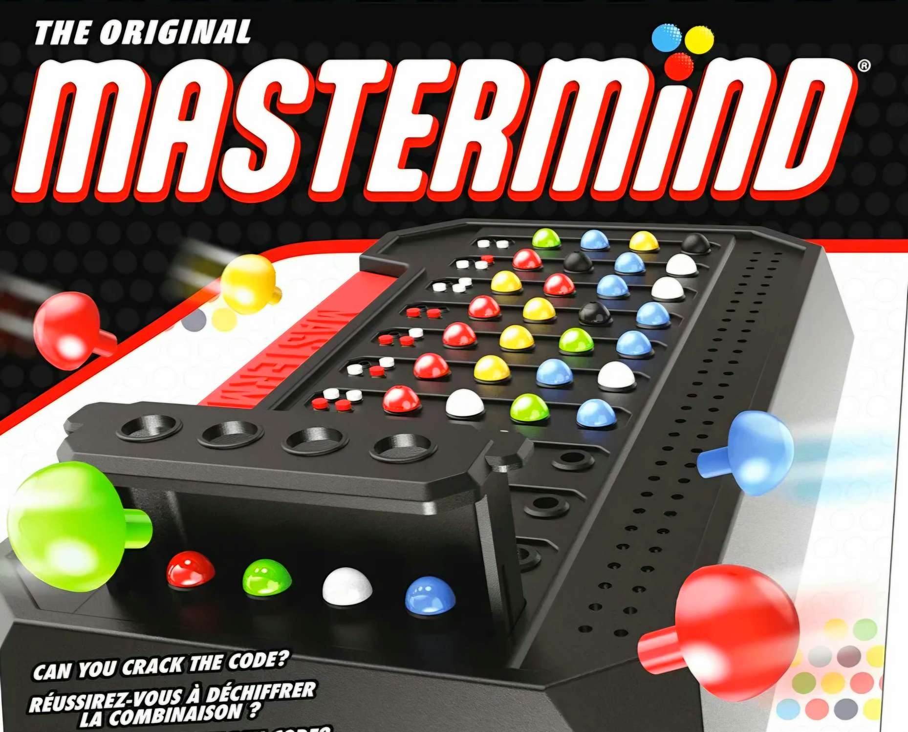

<p align="center">

</p>

<br />

<div align="center">

<a href="https://docs.getbifrost.ai/deployment-guides/how-to/install-make" target="_blank" rel="noopener">
  
</a>

<a href="https://koor.fr/C/Tutorial/Qualificateurs.wp" target="_blank" rel="noopener">
  
</a>

<a href="https://koor.fr/C/Tutorial/Index.wp" target="_blank" rel="noopener">
  
</a>

</div>

<br />
<br />
<br />
<br />
<br />
<br />

<div align="center">

# My Mastermind

<br />



<br/>

*"Mastermind Board Game"*

</div>

<br />
<br />

<div align="center">

## Summary

<br />

<h3>
  <a href="#context" style="text-decoration: none;">
    <kbd style="font-size: 0.9em; padding: 0.3em 0.6em; font-weight: bold;">Context</kbd>
  </a>
</h3>


<br />

<h3>
  <a href="#guide" style="text-decoration: none;">
    <kbd style="font-size: 0.9em; padding: 0.3em 0.6em; font-weight: bold;">Guide</kbd>
  </a>
</h3>

<br />

<h3>
  <a href="#more-information" style="text-decoration: none;">
    <kbd style="font-size: 0.9em; padding: 0.3em 0.6em; font-weight: bold;">More Information</kbd>
  </a>
</h3>

<br />

<h3>
  <a href="#download" style="text-decoration: none;">
    <kbd style="font-size: 0.9em; padding: 0.3em 0.6em; font-weight: bold;">Download</kbd>
  </a>
</h3>

<br />

<h3>
  <a href="#credits" style="text-decoration: none;">
    <kbd style="font-size: 0.9em; padding: 0.3em 0.6em; font-weight: bold;">Credits</kbd>
  </a>
</h3>

<br />
<br />

> Clickable Buttons !

</div>

<br />
<br />


<div align="center">

<h2 id="context">Context</h2>

</div>

<br />

> ---
>
> A client requested a **custom Mastermind desktop game** in which players must crack a **4-character secret code** composed of **digits ranging from "0" to "8"**. The **application requires a round-based attempt system** and **robust input validation** to **ensure code security** and **user error handling**. To meet these requirements with **optimal performance** and **low-level control**, I chose to develop the game in **"C"**.
>
> ---

<br />

<div align="center">


<br />

*"C Language Logo"*


<br />
<br />

<h2 id="guide">Guide</h2>

</div>

<br />

> <a href="https://docs.getbifrost.ai/deployment-guides/how-to/install-make" target="_blank" rel="noopener">
>  
> </a>
> <br>
> <br>
> 
> First, I created a **Makefile** to **compile the project cleanly** using **gcc** along with strict **warning flags** (**-Wall -Wextra -Werror**). This ensures the **code compiles without warnings** or **undetected bugs** before creating the final **"my_mastermind executable"**.
> <br>
>
> #### Compilation & Build
>
> The project includes a **Makefile** to handle compilation with **`gcc`**. To maintain high standards and prevent undefined behavior, the project is compiled using strict safety flags: **`-Wall -Wextra -Werror`**.
> <br>
>
> #### Available Rules:
>
> * **`make`** / **`make all`:** Compiles the project and generates the **`my_mastermind`** executable.
> <br>
>
> * **`make clean`:** **Removes object files** (`.o`).
> <br>
>
> * **`make fclean`:** **Removes object files** and the **generated executable**.
> <br>
> 
> * **`make re`:** Performs a **clean re-compilation** (`fclean` followed by `all`).

```Makefile
CC = gcc
CFLAGS = -Wall -Wextra -Werror
NAME = my_mastermind
SRCS = my_mastermind.c
OBJS = $(SRCS:.c=.o)

all: $(NAME)

$(NAME): $(OBJS)
    $(CC) $(CFLAGS) $(OBJS) -o $(NAME)

%.o: %.c
    $(CC) $(CFLAGS) -c $< -o $@

clean:
    rm -f $(OBJS)

fclean: clean
    rm -f $(NAME)

re: fclean all

.PHONY: all clean fclean re
```

<br />
<br />
<br />
<br />

> <a href="https://koor.fr/C/Tutorial/Qualificateurs.wp" target="_blank" rel="noopener">
>  
> </a>
> <br>
> <br>
> 
> Next, I created a **custom header** file (**header.h**) to keep the codebase organized. It includes essential standard libraries (**<stdio.h>**, **<stdlib.h>**, **<unistd.h>**, and **<time.h>**) and centralizes **key game parameters** such as **CODE_SIZE**, **DEFAULT_ATTEMPTS**, and **VALID_PIECES**. It also declares prototypes for utility **string functions** (**my_strlen**, **my_strcmp**, **my_atoi**) and **core game logic functions** (**is_valid_code**, **generate_random_code**, **evaluate_guess**). By **including this header** in **source files**, the **implementation code** remains **clean** and **focused** strictly on the **game's execution logic**.
> <br>
>
>#### Standard Libraries Included:
>
> * **`<stdio.h>`:** Standard Input/Output operations.
> <br>
>
> * **`<stdlib.h>`:** Memory allocation (**`malloc`**, **`free`**) and **random number generation**.
> <br>
>
> * **`<unistd.h>`:** Low-level POSIX system calls such as **`read()`** and **`write()`**.
> <br>
>
> * **`<time.h>`:** **Time utilities** used to seed the **pseudo-random number generator**.
> <br>
>
> #### Constants & Configuration:
>
> * **`CODE_SIZE` (4):** **Length** of the **secret code**.
> <br>
>
> * **`DEFAULT_ATTEMPTS` (10):** Default **number** of **rounds/attempts** available to the **player**.
> <br>
>
> * **`VALID_PIECES` ("012345678"):** **Allowed characters** for **guesses** and **code generation**.
> <br>
>
> #### Prototypes:
>
> * **String Helpers:** **`my_strlen`**, **`my_strcmp`**, **`my_atoi`**.
> <br>
>
> * **Game Logic:** **`is_valid_code`**, **`generate_random_code`**, **`evaluate_guess`**.

> [!NOTE] 
> Including **`header.h`** in **`.c` files** avoids **cluttering** the implementation logic with repetitive includes and definitions, keeping the **main game logic concise and readable**.

```C
#ifndef HEADER_H
#define HEADER_H

#include <stdio.h>
#include <stdlib.h>
#include <unistd.h>
#include <time.h>

#define CODE_SIZE 4
#define DEFAULT_ATTEMPTS 10
#define VALID_PIECES "012345678"

int my_strlen(const char *str);
int my_strcmp(const char *s1, const char *s2);
int my_atoi(const char *str);
int is_valid_code(const char *code);
char *generate_random_code(void);
void evaluate_guess(const char *secret, const char *guess, int *well_placed, int *misplaced);

#endif
```

<br />
<br />
<br />
<br />

> ---
>
> <a href="https://koor.fr/C/Tutorial/Index.wp" target="_blank" rel="noopener">
>  
> </a>
> <br>
> <br>
> 
> Finally, I implemented the core game logic in **pure C**, focusing on **modularity**, **robust memory management**, and efficient **input validation**.
>
> ---

<br />

> I included the **header**.

```C
#include "header.h"
```

<br />
<br />

> To keep the **project lightweight**, **self-contained**, and **independent of external libraries**, I **implemented custom utility functions** for **string handling** and **strict input security**:
>
> **my_strlen:** Calculates the **length** of a **string** safely.
>
> **my_strcmp:** Compares **two strings character by character**.
>
> **my_atoi:** Converts numeric **string** representations into **integers**.
>
> **is_valid_code:** Performs strict character security checks—ensuring the code matches the required **length (CODE_SIZE)**, contains only **valid digits (0 to 8)**, and **features unique**, **non-repeating characters**.

```C
int my_strlen(const char *str) {
    int len = 0;
    while (str && str[len] != '\0') {
        len++;
    }
    return len;
}

int my_strcmp(const char *s1, const char *s2) {
    int i = 0;
    while (s1[i] && s2[i] && s1[i] == s2[i]) {
        i++;
    }
    return (unsigned char)s1[i] - (unsigned char)s2[i];
}

int my_atoi(const char *str) {
    int res = 0;
    int i = 0;
    while (str[i] >= '0' && str[i] <= '9') {
        res = res * 10 + (str[i] - '0');
        i++;
    }
    return res;
}

int is_valid_code(const char *code) {
    if (!code || my_strlen(code) != CODE_SIZE) {
        return 0;
    }

    for (int i = 0; i < CODE_SIZE; i++) {
        if (code[i] < '0' || code[i] > '8') {
            return 0;
        }
        for (int j = i + 1; j < CODE_SIZE; j++) {
            if (code[i] == code[j]) {
                return 0;
            }
        }
    }
    return 1;
}
```

<br />
<br />
<br />

> If **no custom secret code is specified by the user via command-line arguments**, the **program automatically generates** a secure **4-digit code** using unique **characters** ranging from **0 to 8**.
> 
> The **generate_random_code** function seeds the **pseudo-random number generator** using **<**time.h**>**, populates a static **character buffer**, and checks for duplicates on the fly to guarantee that all digits in the secret code are **strictly unique**.

```C
char *generate_random_code(void) {
    static char code[CODE_SIZE + 1];
    int count = 0;

    srand((unsigned int)time(NULL));
    while (count < CODE_SIZE) {
        char digit = '0' + (rand() % 9);
        int exists = 0;
        for (int i = 0; i < count; i++) {
            if (code[i] == digit) {
                exists = 1;
                break;
            }
        }
        if (!exists) {
            code[count++] = digit;
        }
    }
    code[CODE_SIZE] = '\0';
    return code;
}
```

<br />
<br />
<br />

> To provide **real-time feedback** during the **game**, the **evaluate_guess function** compares the **player's guess against the secret code**, accurately calculating the number of **well-placed pieces** (correct digit and correct position) and **misplaced pieces** (**correct digit but wrong position**).
>
> Additionally, **player interaction** is managed through **read_guess**, which utilizes **low-level POSIX** system calls (**read()** from **<**unistd.h**>** via **STDIN_FILENO**) to safely capture and parse user input line by line from **standard input**.

```C
void evaluate_guess(const char *secret, const char *guess, int *well_placed, int *misplaced) {
    *well_placed = 0;
    *misplaced = 0;
    int used_secret[CODE_SIZE] = {0};
    int used_guess[CODE_SIZE] = {0};

    for (int i = 0; i < CODE_SIZE; i++) {
        if (guess[i] == secret[i]) {
            (*well_placed)++;
            used_secret[i] = 1;
            used_guess[i] = 1;
        }
    }

    for (int i = 0; i < CODE_SIZE; i++) {
        if (used_guess[i]) {
            continue;
        }
        for (int j = 0; j < CODE_SIZE; j++) {
            if (!used_secret[j] && guess[i] == secret[j]) {
                (*misplaced)++;
                used_secret[j] = 1;
                break;
            }
        }
    }
}

static int read_guess(char *buffer) {
    int idx = 0;
    char ch;

    while (read(STDIN_FILENO, &ch, 1) > 0) {
        if (ch == '\n') {
            buffer[idx < CODE_SIZE ? idx : CODE_SIZE] = '\0';
            return 1;
        }
        if (idx < CODE_SIZE) {
            buffer[idx] = ch;
        }
        idx++;
    }

    if (idx > 0) {
        buffer[idx < CODE_SIZE ? idx : CODE_SIZE] = '\0';
        return 1;
    }
    return 0;
}
```

<br />
<br />
<br />

> The **`main`** function handles the **core game** orchestration and **command-line arguments**:
> <br>
>**Argument Parsing:** 
> * **`-c [code]`**: Allows setting a custom secret code.
> <br>
> * **`-t [attempts]`**: Specifies a **custom number** of **rounds** (defaults to **`DEFAULT_ATTEMPTS`**).
> <br>
> 
>**Game Loop:** Manages **round progression**, prompts the player for **inputs** using **low-level output**, and handles **invalid inputs** gracefully with a **"Wrong input!"** message without **wasting an attempt**.
> <br>
> 
>**Evaluation & Victory:** Compares **guesses** via **`evaluate_guess`**, outputs **real-time** feedback on **well-placed** and **misplaced pieces**, and checks for the win condition to **terminate successfully**.


```C
int main(int argc, char **argv) {
    char *secret_code = NULL;
    int max_attempts = DEFAULT_ATTEMPTS;

    for (int i = 1; i < argc; i++) {
        if (my_strcmp(argv[i], "-c") == 0 && i + 1 < argc) {
            secret_code = argv[i + 1];
            i++;
        } else if (my_strcmp(argv[i], "-t") == 0 && i + 1 < argc) {
            max_attempts = my_atoi(argv[i + 1]);
            i++;
        }
    }

    if (!secret_code) {
        secret_code = generate_random_code();
    }

    printf("Will you find the secret code?\nPlease enter a valid guess\n");

    int attempt = 0;
    char guess[CODE_SIZE + 1];

    while (attempt < max_attempts) {
        printf("---\nRound %d\n", attempt);
        write(STDOUT_FILENO, ">", 1);

        if (!read_guess(guess)) {
            return 0;
        }

        if (!is_valid_code(guess)) {
            printf("Wrong input!\n");
            continue;
        }

        int well_placed = 0, misplaced = 0;
        evaluate_guess(secret_code, guess, &well_placed, &misplaced);

        if (well_placed == CODE_SIZE) {
            printf("Congratz! You did it!\n");
            return 0;
        }

        printf("Well placed pieces: %d\nMisplaced pieces: %d\n", well_placed, misplaced);
        attempt++;
    }

    return 0;
}
```

<br />
<br />
<br />
<br />

<div align="center">

<h2 id="more-information">More Information</h2>

<br />

</div>

> ---
>
> **my_strlen( ):** Returns the **length** of a **null-terminated string**.
> 
> **my_strcmp( ):** Compares **two strings character by character**.
> 
> **my_atoi( ):** Converts a **numerical ASCII string** to an **integer value**.
> 
> **is_valid_code( ):** Validates that **input** contains exactly **4 unique digits** between **'0' and '8'**.
> 
> **generate_random_code( ):** Produces a **random secret code** without **duplicated digits**.
> 
> **evaluate_guess( ):** Counts **exact matches** (**well placed**) and **misplaced digits** using a **two-pass lookup** to handle **duplicate inputs cleanly**.
> 
> **read_guess( ):** Reads input stream **character by character using read()**, guarantees **null-termination (\0)**, and **handles EOF**.
> 
> ---

> [!NOTE]
> The application accepts optional command-line flags:
> * **-c [code] :** Sets a **custom secret code** (e.g. **./my_mastermind -c 0123**).
> <br>
> 
> * **-t [attempts] :** Specifies the **maximum number of attempts allowed** (e.g. **./my_mastermind -t 5**).

<br />

> [!WARNING]
> **Before playing:** Make sure to **compile the program first** by running **"make"** in your terminal.

<br />
<br />

<div align="center">

<h2 id="download">Download</h2>

</div>

<br />

> ---
>
> #### Prerequisites:
> **Make sure** you have **installed** on your **system**:
>
> <br>
> 
> <a href="https://code.visualstudio.com/docs/cpp/config-mingw" target="_blank" rel="noopener">
>   
> </a>
>  and
> <a href="https://docs.getbifrost.ai/deployment-guides/how-to/install-make" target="_blank" rel="noopener">
>   
> </a> 
> 
> <br>
> <br>
> <br>
> <br>
> 
> To **compile the project**, run the **terminal command**:
> * **" make "** .
> 
> To **execute** the **game**:
> * **" ./my_mastermind "** .
> 
> The **project** can be directly downloaded on **GitHub**.
>
> ---

<br />
<br />

| Files | Defintion | 
|:---:|:---|
|**Makefile**| **Compile my_mastermind.c** and create a **"my_mastermind executor"**.|
|**header.h**|Stock **variables, functions and libraries** which will be **included in my_mastermind.c** with **"include header.h"**.|
|**Mastermind.c**|**Game's Core**.|

<br />
<br />

<div align="center">

<h2 id="credits">Credits</h2>

</div>

<br />

<p align="center">

<a href="https://github.com/EliasFCS" target="_blank" rel="noopener">
  
</a>