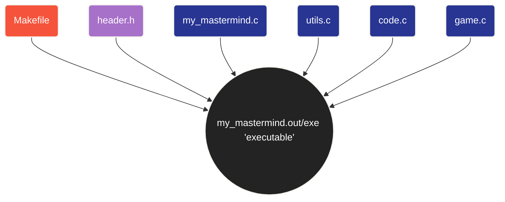

<p align="center">

</p>

<br />

<div align="center">

<a href="https://docs.getbifrost.ai/deployment-guides/how-to/install-make" target="_blank" rel="noopener">
  
</a>

<a href="https://koor.fr/C/Tutorial/Qualificateurs.wp" target="_blank" rel="noopener">
  
</a>

<a href="https://koor.fr/C/Tutorial/Index.wp" target="_blank" rel="noopener">
  
</a>

</div>

<br />
<br />
<br />
<br />
<br />
<br />

<div align="center">

# My Mastermind

<br />


<br/>

*"Mastermind Board Game"*

</div>

<br />
<br />

<div align="center">

## Summary

<br />

<h3>
  <a href="#context" style="text-decoration: none;">
    <kbd style="font-size: 0.9em; padding: 0.3em 0.6em; font-weight: bold;">Context</kbd>
  </a>
</h3>


<br />

<h3>
  <a href="#guide" style="text-decoration: none;">
    <kbd style="font-size: 0.9em; padding: 0.3em 0.6em; font-weight: bold;">Guide</kbd>
  </a>
</h3>

<br />

<h3>
  <a href="#more-information" style="text-decoration: none;">
    <kbd style="font-size: 0.9em; padding: 0.3em 0.6em; font-weight: bold;">More Information</kbd>
  </a>
</h3>

<br />

<h3>
  <a href="#download" style="text-decoration: none;">
    <kbd style="font-size: 0.9em; padding: 0.3em 0.6em; font-weight: bold;">Download</kbd>
  </a>
</h3>

<br />

<h3>
  <a href="#credits" style="text-decoration: none;">
    <kbd style="font-size: 0.9em; padding: 0.3em 0.6em; font-weight: bold;">Credits</kbd>
  </a>
</h3>

<br />
<br />

> Clickable Buttons !

</div>

<br />
<br />


<div align="center">

<h2 id="context">Context</h2>

</div>

<br />

> ---
>
> A client requested a **custom Mastermind desktop game** in which players must crack a **4-character secret code** composed of **digits ranging from "0" to "8"**. The **application requires a round-based attempt system** and **robust input validation** to **ensure code security** and **user error handling**. To meet these requirements with **optimal performance** and **low-level control**, I chose to develop the game in **"C"**.
>
> ---

<br />

<div align="center">


<br />

*"C Language Logo"*


<br />
<br />

<h2 id="guide">Guide</h2>

</div>

<br />

> <a href="https://docs.getbifrost.ai/deployment-guides/how-to/install-make" target="_blank" rel="noopener">
>  
> </a>
> <br>
> <br>
> 
> First, I created a **Makefile** to **compile the project cleanly** using **gcc** along with strict **warning flags** (**-Wall -Wextra -Werror**). This ensures the **code compiles without warnings** or **undetected bugs** before creating the final **"my_mastermind executable"**.
> <br>
>
> #### Compilation & Build
>
> The project includes a **Makefile** to handle compilation with **`gcc`**. To maintain high standards and prevent undefined behavior, the project is compiled using strict safety flags: **`-Wall -Wextra -Werror`**.
> <br>
>
> #### Available Rules:
>
> * **`make`: Compiles the project** and generates the **`my_mastermind`** executable.
> <br>
>
> * **`make clean`:** **Removes object files** (`.o`).
> <br>
>
> * **`make fclean`:** **Removes object files** and the **generated executable**.
> <br>
> 
> * **`make re`:** Performs a **clean re-compilation** (`fclean` followed by `all`).

```Makefile
CC = gcc
CFLAGS = -Wall -Wextra -Werror
NAME = my_mastermind
SRCS = my_mastermind.c utils.c code.c game.c
OBJS = $(SRCS:.c=.o)

all: $(NAME)

$(NAME): $(OBJS)
	$(CC) $(CFLAGS) $(OBJS) -o $(NAME)

%.o: %.c header.h
	$(CC) $(CFLAGS) -c $< -o $@

clean:
	rm -f $(OBJS)

fclean: clean
	rm -f $(NAME)

re: fclean all

.PHONY: all clean fclean re
```

<br />
<br />
<br />
<br />

> <a href="https://koor.fr/C/Tutorial/Qualificateurs.wp" target="_blank" rel="noopener">
>  
> </a>
> <br>
> <br>
> 
> Next, I created a **custom header** file (**header.h**) to keep the codebase organized. It includes essential standard libraries (**<stdio.h>**, **<stdlib.h>**, **<unistd.h>**, and **<time.h>**) and centralizes **key game parameters** such as **CODE_SIZE**, **DEFAULT_ATTEMPTS**, and **VALID_PIECES**. It also declares prototypes for utility **string functions** (**my_strlen**, **my_strcmp**, **my_atoi**) and **core game logic functions** (**is_valid_code**, **generate_random_code**, **evaluate_guess**). By **including this header** in **source files**, the **implementation code** remains **clean** and **focused** strictly on the **game's execution logic**.
> <br>
>
>#### Standard Libraries Included:
>
> * **`<stdio.h>`:** Standard Input/Output operations.
> <br>
>
> * **`<stdlib.h>`:** Memory allocation (**`malloc`**, **`free`**) and **random number generation**.
> <br>
>
> * **`<unistd.h>`:** Low-level POSIX system calls such as **`read()`** and **`write()`**.
> <br>
>
> * **`<time.h>`:** **Time utilities** used to seed the **pseudo-random number generator**.
> <br>
>
> #### Constants & Configuration:
>
> * **`CODE_SIZE` (4):** **Length** of the **secret code**.
> <br>
>
> * **`DEFAULT_ATTEMPTS` (10):** Default **number** of **rounds/attempts** available to the **player**.
> <br>
>
> * **`VALID_PIECES` ("012345678"):** **Allowed characters** for **guesses** and **code generation**.
> <br>
>
> #### Prototypes:
>
> * **String Helpers:** **`my_strlen`**, **`my_strcmp`**, **`my_atoi`**.
> <br>
>
> * **Game Logic:** **`is_valid_code`**, **`generate_random_code`**, **`evaluate_guess`**.

> [!NOTE] 
> Including **`header.h`** in **`.c` files** avoids **cluttering** the implementation logic with repetitive includes and definitions, keeping the **main game logic concise and readable**.

```c
#ifndef HEADER_H
#define HEADER_H

#include <stdio.h>
#include <stdlib.h>
#include <unistd.h>
#include <time.h>

#define CODE_SIZE 4
#define DEFAULT_ATTEMPTS 10
#define VALID_PIECES "012345678"

int my_strlen(const char *str);
int my_strcmp(const char *s1, const char *s2);
int my_atoi(const char *str);

int is_valid_code(const char *code);
char *generate_random_code(void);

void evaluate_guess(const char *secret, const char *guess,
int *well_placed, int *misplaced);

int read_guess(char *buffer);

#endif
```

<br />
<br />
<br />
<br />

> ---
>
> 
> Finally, I implemented the core game logic in **pure C**, focusing on **modularity**, **robust memory management**, and efficient **input validation**.
>
> 
> ---

<br />

> <a href="https://koor.fr/C/Tutorial/Index.wp" target="_blank" rel="noopener">
>  
> </a>
>
> <br />
>
> #### " my_mastermind.c " : 
> 
> This file contains the **main function** of the **Mastermind game**. It manages the game settings, checks the **secret code**, and handles the player's attempts.
>
> First, the program reads the **command-line arguments**. The **`-c`** option allows the player to choose a **secret code**, while the **`-t`** option sets the **maximum number of attempts**. **If no secret code is provided, the program generates a random one**. It also checks that the number of **attempts is positive and that the secret code is valid**.
>
> **The program then displays a welcome message and starts the game loop**. At each round, it asks the player to enter a guess. The function **`read_guess()`** reads the **input**, and **`is_valid_code()`** checks whether the guess is **valid**. If the input is **invalid**, the program displays an **error message** and asks the **player to try again**.
>
> If the **guess is valid**, the function **`evaluate_guess()`** compares it with the **secret code** and calculates the number of **well-placed** and **misplaced pieces**. If all **four digits** are **correct** and in the right positions, the player wins, and the program displays a **congratulation message**.
>
> Otherwise, the program **displays the results** and continues to the **next round** until the **maximum number** of **attempts is reached**. Finally, the program **ends**.

```C
#include "header.h"

int main(int argc, char **argv)
{
char *secret_code = NULL;
int max_attempts = DEFAULT_ATTEMPTS;
int attempt = 0;
int well_placed;
int misplaced;
int i = 1;
char guess[CODE_SIZE + 1];

while (i < argc) {
    if (my_strcmp(argv[i], "-c") == 0 && i + 1 < argc) {
        secret_code = argv[i + 1];
        i += 2;
    } else if (my_strcmp(argv[i], "-t") == 0 && i + 1 < argc) {
        max_attempts = my_atoi(argv[i + 1]);
        i += 2;
    } else {
        i++;
    }
}

if (max_attempts <= 0) {
    return 1;
}

if (!secret_code) {
    secret_code = generate_random_code();
} else if (!is_valid_code(secret_code)) {
    return 1;
}

printf("Will you find the secret code?\n");
printf("Please enter a valid guess\n");

while (attempt < max_attempts) {
    printf("---\nRound %d\n", attempt);
    write(1, ">", 1);

    if (!read_guess(guess)) {
        return 0;
    }

    if (!is_valid_code(guess)) {
        printf("Wrong input!\n");
        continue;
    }

    evaluate_guess(secret_code, guess, &well_placed, &misplaced);

    if (well_placed == CODE_SIZE) {
        printf("Congratz! You did it!\n");
        return 0;
    }

    printf("Well placed pieces: %d\n", well_placed);
    printf("Misplaced pieces: %d\n", misplaced);
    attempt++;
}

return 0;

}
```

<br />
<br />

> <a href="https://koor.fr/C/Tutorial/Index.wp" target="_blank" rel="noopener">
>  
> </a>
>
> <br />
>
> #### " utils.c " : 
>
> This file contains **three utility functions** that handle **basic string operations**.
>
>The **`my_strlen()`** function calculates the **length of a string** by counting its characters until it reaches the **`null terminator ('\0')`**. If the string is **`NULL`**, it **returns `0`**.
>
> The **`my_strcmp()`** function compares **two strings character by character**. It stops when the characters are different or when one of the strings reaches the end. It **returns `0`** if the strings are identical, a **negative value** if the **first string is smaller**, or a **positive value** if the **first string is greater**.
>
> The **`my_atoi()`** function converts a string containing **digits into an integer**. It **reads each digit and builds** the result by multiplying the **current value by `10`** and adding the next digit. It stops when it **encounters a character** that is **not a digit**.


```C
#include "header.h"

int my_strlen(const char *str)
{
int len = 0;

while (str && str[len] != '\0') {
    len++;
}
return len;

}

int my_strcmp(const char *s1, const char *s2)
{
int i = 0;

while (s1[i] && s2[i] && s1[i] == s2[i]) {
    i++;
}
return (unsigned char)s1[i] - (unsigned char)s2[i];

}

int my_atoi(const char *str)
{
int res = 0;
int i = 0;

while (str[i] >= '0' && str[i] <= '9') {
    res = res * 10 + (str[i] - '0');
    i++;
}
return res;

}
```

<br />
<br />
<br />

> <a href="https://koor.fr/C/Tutorial/Index.wp" target="_blank" rel="noopener">
>  
> </a>
>
> <br />
>
> #### " code.c " : 
>
> This file contains two functions responsible for validating and generating the secret code.
>
>The **`is_valid_code()`** function checks whether a **code is valid**. It verifies that **the code is not NULL**, contains exactly **four characters**, uses only **digits from `0` to `8`**, and does not contain any **repeated digits**. If one of these conditions is not met, the function **returns `0`. Otherwise**, it **returns `1`**.
>
>The **`generate_random_code()`** function **generates a random secret code** containing **four unique digits** between **`0` and `8`**. It uses **`rand()`** to select digits and checks whether each digit has already been used before adding it to the code. Once four different digits have been selected, the function adds a **`null terminator ('\0')`** to mark the end of the **string and returns the generated code**.
>
> 

```C
#include "header.h"

int is_valid_code(const char *code)
{
int i = 0;
int j = 0;

if (!code || my_strlen(code) != CODE_SIZE) {
    return 0;
}

while (i < CODE_SIZE) {
    if (code[i] < '0' || code[i] > '8') {
        return 0;
    }
    j = i + 1;
    while (j < CODE_SIZE) {
        if (code[i] == code[j]) {
            return 0;
        }
        j++;
    }
    i++;
}
return 1;

}

char *generate_random_code(void)
{
static char code[CODE_SIZE + 1];
int count = 0;
int i;
int exists;
char digit;

srand((unsigned int)time(NULL));
while (count < CODE_SIZE) {
    digit = '0' + rand() % 9;
    exists = 0;
    i = 0;
    while (i < count) {
        if (code[i] == digit) {
            exists = 1;
        }
        i++;
    }
    if (!exists) {
        code[count] = digit;
        count++;
    }
}
code[CODE_SIZE] = '\0';
return code;

}
```

<br />
<br />
<br />

> <a href="https://koor.fr/C/Tutorial/Index.wp" target="_blank" rel="noopener">
>  
> </a>
>
> <br />
>
> #### " game.c " :
>  
>This **file contains two functions** that handle the player's input and **evaluate their guesses**.
>
>The **`read_guess()`** function reads the player's **input one character** at a time using **`read()`**. It checks whether the player has entered **exactly four characters**. If the input is **too short or too long**, it is **considered invalid**. The function also handles **errors and detects when the player exits the input**. If the input is **valid in length**, it adds a **`null terminator ('\0')`** to mark the **end of the string**.
>
>The **`evaluate_guess()`** function compares the player's **guess with the secret code**. It first counts the **well-placed pieces**, which are **digits** that are correct and in the **right positions**. Then, it counts the **misplaced pieces**, which are **correct digits** in the **wrong positions**. Two arrays, **used_secret** and **used_guess**, keep track of the digits that have already been counted, preventing the same digit from being counted more than once. Finally, the function returns the results through the **`well_placed`** and **`misplaced pointers`**. 

```C
#include "header.h"

int read_guess(char *buffer)
{
char c;
int len = 0;
int overflow = 0;
ssize_t bytes_read;

while ((bytes_read = read(0, &c, 1)) > 0) {
    if (c == '\n') {
        break;
    }
    if (len < CODE_SIZE) {
        buffer[len] = c;
    } else {
        overflow = 1;
    }
    len++;
}
if (bytes_read == 0 && len == 0) {
    return 0;
}
if (bytes_read < 0) {
    return 0;
}
if (len != CODE_SIZE || overflow) {
    buffer[0] = '\0';
    return 1;
}
buffer[CODE_SIZE] = '\0';
return 1;

}

void evaluate_guess(const char *secret, const char *guess,
int *well_placed, int *misplaced)
{
int used_secret[CODE_SIZE] = {0};
int used_guess[CODE_SIZE] = {0};
int i = 0;
int j;

*well_placed = 0;
*misplaced = 0;

while (i < CODE_SIZE) {
    if (guess[i] == secret[i]) {
        (*well_placed)++;
        used_secret[i] = 1;
        used_guess[i] = 1;
    }
    i++;
}

i = 0;
while (i < CODE_SIZE) {
    if (!used_guess[i]) {
        j = 0;
        while (j < CODE_SIZE) {
            if (!used_secret[j] && guess[i] == secret[j]) {
                (*misplaced)++;
                used_secret[j] = 1;
                break;
            }
            j++;
        }
    }
    i++;
}

}
```

<br />
<br />
<br />
<br />

<div align="center">

<h2 id="more-information">More Information</h2>

<em>Technical overview of the main functions and game logic.</em>

<br />

</div>

> ---
> 
> #### 1. Utility Functions:
>
> These functions provide basic string manipulation and conversion operations used throughout the project.
>
> | Function | Description | 
> |:---:|:---|
> |my_strlen()|Calculates the length of a null-terminated string.|
> |my_strcmp()|Compares two strings character by character and returns the difference between the first pair of differing characters.|
>|my_atoi()|Converts a string containing numeric characters into an integer.|
>
> <br>
>
>#### 2. Code Validation and Generation:
>
> These functions ensure that the secret code follows the game's rules.
>
>
>| Function | Description | 
> |:---:|:---|
> |is_valid_code()|Checks whether a code contains exactly four digits between '0' and '8', with no repeated digits.|
> |generate_random_code()| Generates a four-digit secret code with unique digits selected from '0' to '8'.|
>
>
>The validation function helps ensure that the secret code follows the expected format before the game begins.
>
> <br>
>
> #### 3. Guess Evaluation:
>
>The evaluate_guess() function compares the player's guess with the secret code and calculates two values:
>
> * Well-placed pieces: Digits that match the secret code in both value and position.
> <br>
> 
> * Misplaced pieces: Digits that exist in the secret code but appear in a different position.
> 
>The function uses a two-pass comparison strategy to count matches while avoiding counting the same secret digit more than once.
>
> <br>
>
> #### 4. Input Handling:
>
> The read_guess() function reads the player's input from standard input one character at a time using the low-level read() system call.
>
>Its responsibilities include:
>
>* Reading input until a newline character is encountered.
> <br>
>* Storing the input in a buffer.
> <br>
>
>* Ensuring the string is null-terminated when returning a complete input line.
> <br>
> 
>* Handling end-of-file (EOF), allowing the program to exit cleanly when no more input is available.
>
>Input validation is then used to determine whether the >player's guess meets the game's requirements.
>
> <br>
> 
> #### 5. Game Configuration:
>
>The project uses constants defined in header.h to centralize important configuration values.
>
> |Constant |Value |Purpose|
> |:---:|:---:|:---|
> |CODE_SIZE|4|Defines the length of the secret code.|
> |DEFAULT_ATTEMPTS|10|Sets the default number of attempts.|
> |VALID_PIECES|"012345678"|Defines the permitted digits.|
>
>Centralizing these values improves readability and makes the code easier to maintain.
>
> <br>
>
>#### Design Principles
>
>The project is organized around three main principles:
>
>Modularity: Separating utility functions, code operations, and game logic into distinct source files.
Input validation: Checking user input before evaluating a guess.
Maintainability: Using a shared header file for constants and function declarations.
>
>This structure makes the program easier to understand, test, debug, and extend.
> 
> ---

> [!NOTE]
> The application accepts optional command-line flags:
> * **-c [code] :** Sets a **custom secret code** (e.g. **./my_mastermind -c 0123**).
> <br>
> 
> * **-t [attempts] :** Specifies the **maximum number of attempts allowed** (e.g. **./my_mastermind -t 5**).

<br />

> [!WARNING]
> **Before playing:** Make sure to **compile the program first** by running **"make"** in your terminal.

<br />
<br />

<div align="center">

<h2 id="download">Download</h2>

</div>

<br />

> ---
>
> #### Prerequisites:
> **Make sure** you have **installed** on your **system**:
>
> <br>
> 
> <a href="https://code.visualstudio.com/docs/cpp/config-mingw" target="_blank" rel="noopener">
>   
> </a>
>  and
> <a href="https://docs.getbifrost.ai/deployment-guides/how-to/install-make" target="_blank" rel="noopener">
>   
> </a> 
> 
> <br>
> <br>
> <br>
> <br>
> 
> To **compile the project**, run the **terminal command**:
> * **" make " or "make re"**.
> 
> To **execute** the **game**:
> * **" ./my_mastermind "** .
> 
> The **project** can be directly downloaded on **GitHub**.
>
> ---

<br />
<br />
<br />

| File | Defintion | 
|:---:|:---|
|| ||
|**Makefile**| **Compile my_mastermind.c** and create a **"my_mastermind executor"**.|
|**header.h**|Stock **variables, functions prototypes and libraries** which will be **included in my_mastermind.c** with **"include header.h"**.|
|**my_mastermind.c**|**Entry point** and **command-line argument handling**.|
|**utils.c**|**Utility functions** for **string handling** and **numeric conversion**. |
|**code.c**|**Secret-code generation** and **code validation**. |
|**game.c**| **Game logic**, **guess evaluation**, and **input handling** |

<br />
<br />
<br />

<div align="center">



*"Project's Composition"*

</div>

<br />
<br />
<br />
<br />
<br />
<br />

<div align="center">

<h2 id="credits">Credits</h2>

</div>

<br />

<p align="center">

<a href="https://github.com/EliasFCS" target="_blank" rel="noopener">
  
</a>